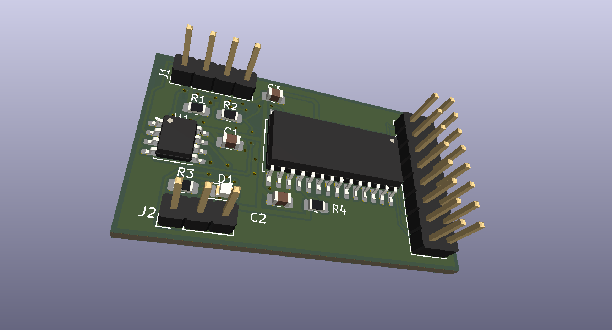
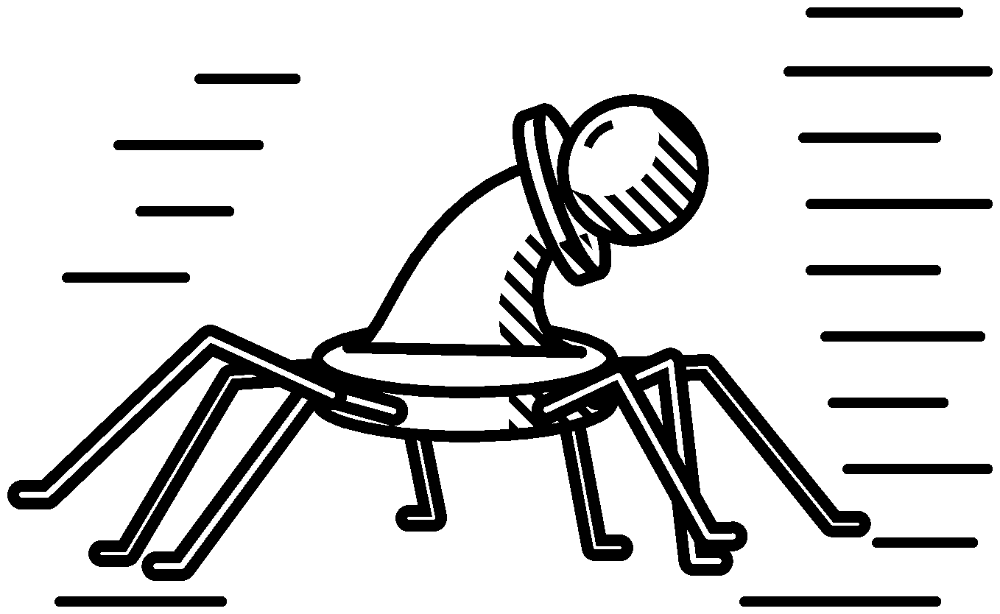

# TinyMate — Journal

Format: date · time spent · what I did · decisions · problems · screenshots.
(Write each entry in your own words.)

---

## 2026-11-16 · 17:15–18:15 · 1h

**Research:** I spent the first part of this session researching Hack Club programs
and the 8-Pin Grant rules, and exploring project ideas that would fit them.
I landed on a smart chessboard that detects the pieces and plays online.

**Decision:** the ATtiny412 only has 8 pins (5 usable, after power and programming),
and with my mental sketch I needed 16 to read all 64 squares as an 8×8 matrix,
plus 2 for communication. So I added an MCP23017, which gives me 16 extra pins
over I2C using just 2 of the ATtiny's.

**Learned:**
- A tiny MCU like the ATtiny412 runs out of pins fast: after power, ground and the
  UPDI programming pin, only 5 are left for the actual project.
- You can get around that with I/O expanders like the MCP23017, which talks over
  I2C and adds 16 pins while using only 2 of the MCU's. The 8-Pin Grant allows one
  expander per board, so it fits the rules.
- How the journal works and how it compares to commits: commits show *what* changed
  in the files, the journal shows *why*, what I tried and how long it took.

**Next step:** build the parts list on DigiKey and start the schematic in KiCad.

---

## 2026-11-16 · 18:15–20:45 · ~2h20

**What I did:** built the parts list on DigiKey (~$9 total, all in stock), then my
first ever KiCad project: full schematic (ATtiny412, MCP23017, pull-ups, status LED,
decoupling caps, 3 connectors), passed ERC with 0 errors / 0 warnings, assigned
footprints, placed everything on the PCB and drew a 42.5 × 33 mm board outline.

**Liked:** that KiCad has generic symbols for everything, and that you only pick the
physical footprint later. The 3D view is awesome, and shoutout to the PCB editor's
dark mode: it has a great style and makes long sessions way easier on the eyes. I only
wish the schematic editor came with a dark theme by default too (turns out you can
install one through the Plugin and Content Manager).

**Problems:**
- The 10µF capacitor I picked was out of stock, so I had to find a substitute.
- The LED was placed backwards, and R3 was wired so the current skipped it.
- I chose the wrong footprint for J1/J2 (a fan connector instead of a plain pin
  header). Footprints come in many variants and it's easy to pick the wrong one.
- I got completely lost placing the components on the PCB, with everything stacked
  on top of each other. I fixed it by separating everything first and then grouping
  parts by function (ATtiny side, MCP23017 in the middle, chess matrix connector on the right).

**Learned:** basically everything, since I had never used KiCad before: schematic →
footprints → PCB, net labels, PWR_FLAG for ERC, reading the ratsnest, and keeping
courtyards at least 1 mm from the board edge.

**Next step:** route the traces, add a ground plane and run DRC.

---

## 2026-11-17 · 17:30–20:15 · ~2h30 (in between calls at work)

**What I did:** set the board rules for OSH Park (0.16 mm trace/clearance, 0.35 mm
drill, 0.75 mm vias, 0.5 mm traces for +5V), routed every connection (power, I2C,
UART, UPDI, LED and the 16 matrix lines to J3) and added a GND plane on both layers.

**Problems:**
- The first DRC run had ~50 violations. Almost all were the same one: my vias had a
  0.175 mm annular ring, under the 0.18 mm minimum. Fixed by bumping vias to 0.75 mm
  and setting clearance to 0.16 mm (still inside OSH Park's 6 mil limit).
- The rest were two vias too close together, a few leftover vias that did nothing and
  GND pads hanging on a single thermal spoke. I couldn't drag the vias cleanly with the
  mouse, so Claude (AI) edited the .kicad_pcb file directly: moved one via 0.5 mm,
  removed 3 unused vias and tuned the GND zone (smaller clearance and thermals, solid
  connection for SMD pads). Result: **0 DRC errors**, 6 silkscreen warnings left.

**Logo:** made a mascot, a pawn running on 8 chip-pin legs. The idea, sketches and
feedback were mine; Claude drew the iterations. It's going on the back silkscreen.

**Learned:** what an annular ring is and why via size matters; that the manufacturer's
limits decide the clearance, not KiCad's defaults; thermal reliefs and "starved
thermals"; routing a matrix with one copper layer per direction.

**Next step:** clean up the silkscreen, place the logo, add part numbers (MPN) to the
BOM and submit to the 8-Pin Grant.
